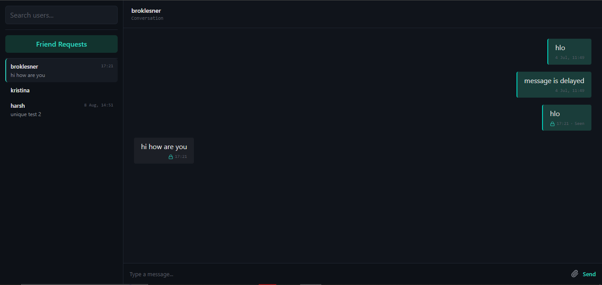
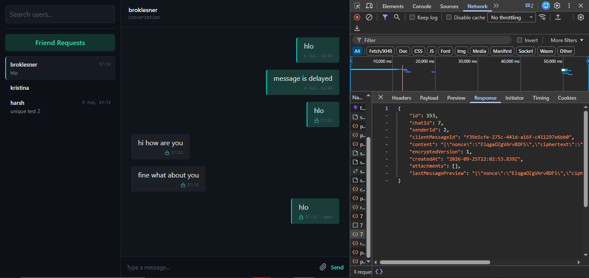
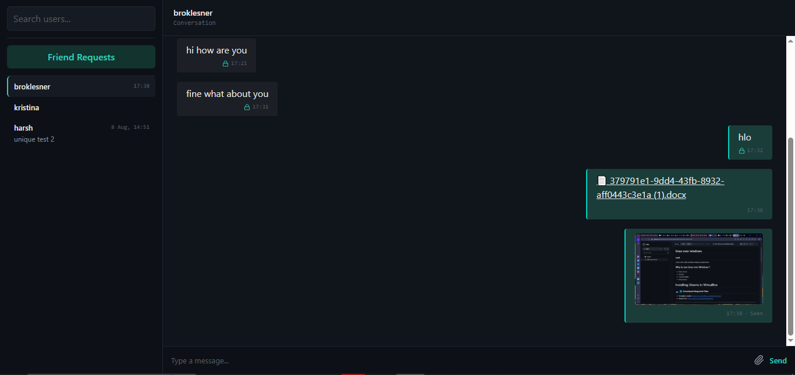
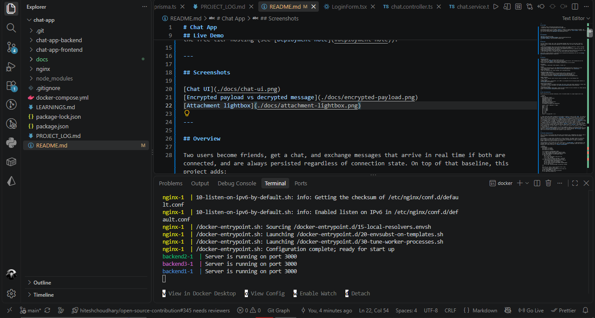
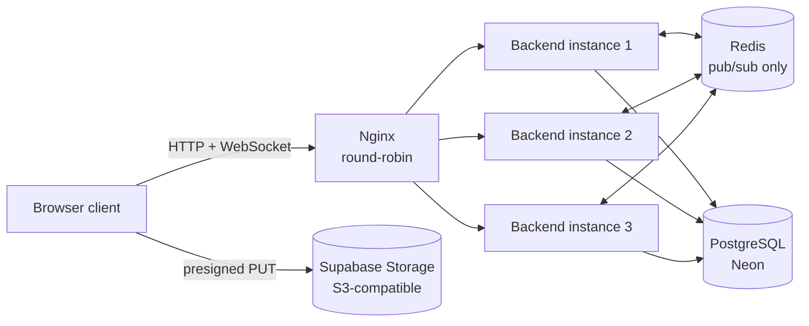
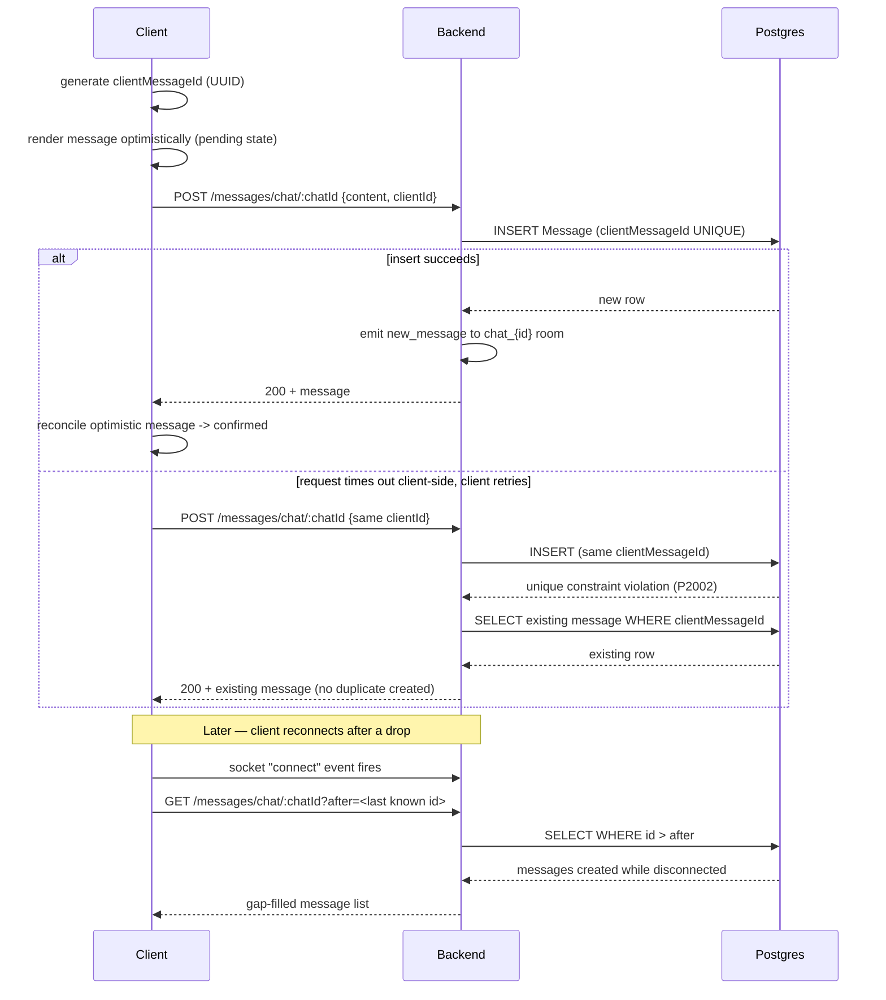
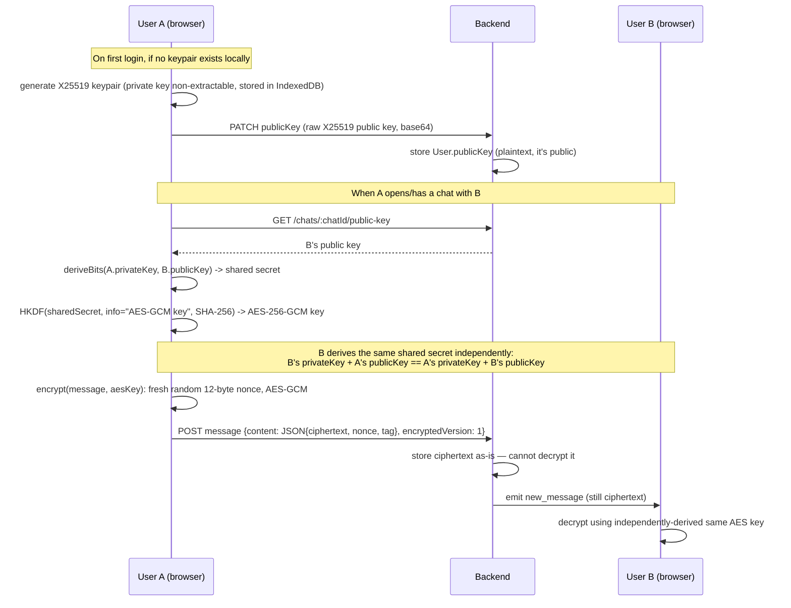

# Cipherline

A real-time, one-to-one messaging application with end-to-end encrypted text messages, idempotent/retry-safe message delivery, and a horizontally scaled backend (multiple instances behind Nginx, coordinated over Redis).

This is a v2 rewrite of an earlier CRUD chat app, rebuilt around the problems real chat systems actually have — duplicate sends, dropped connections, multi-instance fanout — plus end-to-end encryption for message content.

---

## Live Demo

- Frontend: https://chat-app-nine-zeta-94.vercel.app
- Backend API: https://chat-app-backend-tf8s.onrender.com

The deployed instance runs the tagged `stable-v2` release — a single backend instance on Render. The multi-instance/Redis-adapter setup described below is demonstrated via `docker-compose` locally, not on the free-tier hosting (see [Deployment note](#deployment-note)).

---

## Screenshots









---

## Overview

Two users become friends, get a chat, and exchange messages that arrive in real time if both are connected, and are always persisted regardless of connection state. On top of that baseline, this project adds:

- **Delivery guarantees** that survive duplicate requests and dropped connections, without a message queue — using a database unique constraint as the correctness primitive.
- **End-to-end encryption** for text content — the backend stores and relays ciphertext but does not possess the private keys required to decrypt it.
- **Horizontal scaling** of the realtime layer — three backend instances behind one load balancer, kept in sync over Redis, with no in-memory state that would break under multiple instances.

Group chats, typing indicators, and presence were considered and deliberately left out — see [Design decisions](#design-decisions--trade-offs).

---

## Features

**Authentication**
- Registration and login, passwords hashed with bcrypt
- JWT stored in an `HttpOnly` cookie (not accessible to client-side JS, sent automatically by the browser on both HTTP requests and the Socket.IO handshake)
- Route-level auth middleware on the backend; protected routes on the frontend

**Friends**
- Search users, send/accept friend requests, friends list

**Chat**
- One-to-one conversations only (see [Design decisions](#design-decisions--trade-offs) for why)
- Full message history loaded on chat open (no scroll-back pagination — see [Limitations](#known-limitations))
- Chat list ordered by most recent message, with a decrypted preview

**Reliable message delivery**
- Idempotent sends (safe to retry the same message without creating a duplicate)
- Optimistic UI with reconciliation against the server-confirmed message
- Reconnect synchronization (catches up on anything missed while disconnected)
- Full mechanism explained in [Reliable message delivery](#reliable-message-delivery)

**Read receipts**
- Single "Seen" indicator under the most recent own message sent, not per-message ticks

**File uploads**
- Images, audio clips, and documents, up to 20MB, via presigned direct-to-storage uploads (details in [File uploads](#file-uploads))

**End-to-end encryption**
- Text message content is encrypted client-side; the server stores and relays ciphertext it cannot read
- Attachments are **not** encrypted — see [End-to-end encryption](#end-to-end-encryption)

**Horizontal scaling**
- Three backend instances behind Nginx, Socket.IO events fanned out across instances via a Redis pub/sub adapter (see [Horizontal scaling](#horizontal-scaling))

---

## How the System Works

Before getting into individual mechanisms, here's the mental model of a single request end to end.



1. **The client never sends a message over the socket.** Sending is always an HTTP `POST`. The socket is used only for the server to push events (`new_message`, `chat_read`) to connected clients, and for the client to detect connect/disconnect. This single decision is why idempotency, retries, and reconnect sync can all be built as ordinary HTTP + database mechanisms instead of a custom realtime protocol.
2. **A message is never "in flight" only in memory.** By the time any client sees a `new_message` event, the row already exists in Postgres. If nobody is connected to receive that event, the message isn't lost — it's just sitting in the database, retrieved the next time that chat is opened or synced.
3. **Rooms are per-chat, not per-user-pair-computed-on-send.** On socket connect, the server looks up every chat the user is a participant in and joins a `chat_{id}` Socket.IO room for each. When a message is sent, the backend instance that received the HTTP request emits to `chat_{id}` — and because all three instances share the Redis adapter, it doesn't matter which instance the recipient's socket happens to be connected to.
4. **Any of the three backend instances can serve any request.** There is no session affinity, no per-instance state a request depends on. This is what makes the WebSocket-only transport choice possible (details in [Horizontal scaling](#horizontal-scaling)) — an instance handling `POST /messages` doesn't need to be the same instance holding the recipient's socket connection.

---

## Reliable message delivery

This is the part of the project that looks small in the feature list ("idempotency and retries") and is actually the most interconnected piece of the backend — three problems solved with one database constraint.

**The problem.** A client sends a message over a flaky connection. The request times out client-side, but it actually succeeded server-side. The client retries. Without protection, that's a duplicate message. Separately: a client disconnects for 30 seconds and reconnects — it needs to know what it missed, without re-fetching the entire chat history.

**The mechanism.** Every message the client creates gets a `clientMessageId` — a UUID generated on the frontend, before the request is even sent. This is sent alongside the message content and stored as a database-level unique constraint on `Message.clientMessageId`.



Three behaviors fall out of that one constraint:

- **Idempotency**: the backend wraps the insert in a transaction; if it fails with Postgres error `P2002` (unique violation) on `clientMessageId`, it doesn't treat that as an error — it fetches and returns the row that already exists. The client gets a `200` either way, whether this was the first attempt or a retry.
- **Retry**: because retrying is provably safe (same `clientMessageId` in ⇒ same result out, never a duplicate row), the frontend can retry failed sends without any deduplication logic of its own — correctness lives entirely in the unique constraint, not in client bookkeeping.
- **Reconnect sync**: a separate mechanism from idempotency, using a different cursor. On the client's Socket.IO `connect` event, it requests `GET /messages/chat/:chatId?after=<id of the last message the client already has>`. The backend does a plain `WHERE id > after ORDER BY id ASC`. This only fills the gap created by the disconnect — it's not how the chat's initial history loads (see next paragraph), and not a general pagination endpoint.

Opening a chat for the first time loads its entire message history in one query — there is no `before`-cursor / scroll-to-load-older-messages pagination. An early version of the plan (visible in `PROJECT_LOG.md`) called for `GET /messages?before=X`, but it was never built; the cursor above only exists for the forward/reconnect case. See [Known limitations](#known-limitations).

---

## End-to-end encryption

**Scope:** this encrypts text message content between two participants in a single conversation, using one long-lived key pair per user, on a single device. It is not Signal's Double Ratchet, has no forward secrecy, no multi-device support, no key rotation, and does not cover file attachments.

**The flow.**



Implementation details:

- **The private key never leaves the browser**, and is generated non-extractable (`extractable: false` on `crypto.subtle.generateKey`) — the browser's own WebCrypto API refuses to export it even if application code tried to. It lives in IndexedDB, scoped per `userId` (an early version had a global, non-per-user key store and an in-flight generation guard, both of which caused key contamination across accounts on the same browser — fixed by scoping both by user id).
- **One shared AES-GCM key per conversation**, not per-message, not per-recipient. This is different from PGP-style schemes that encrypt separately per recipient — here, because there are only ever two participants and each derives the same key independently via X25519, one key does the job. The key itself is never transmitted or persisted separately — it's re-derived on demand from the (persisted) private key and the other participant's (fetched) public key.
- **Every message still gets a fresh random nonce**, even though the key is reused across the whole conversation — AES-GCM's security guarantee depends entirely on never reusing a nonce under the same key, so this isn't optional. `crypto.getRandomValues` generates a new 12-byte nonce per encrypt call.
- **`encryptedVersion` is a flag on `Message`, not a boolean**: `null` means legacy/plaintext, `1` means "static X25519 + AES-GCM, this scheme." This exists so that a future scheme change (e.g. adding Double Ratchet) has somewhere to go without ambiguity about which old messages used which derivation. Encryption isn't a per-message opt-in toggle from the user's side — a message is encrypted whenever it has text content and the sender has a key pair; there's no "send unencrypted" option in the UI.
- **The `Chat.lastMessage` sidebar preview** is also just the encrypted JSON blob server-side — the server cannot generate a readable preview. Decryption for the preview happens client-side, cached separately from the main message list to avoid a decrypt loop on every chat-list re-render.
- **What the server sees:** both users' public keys (public by design), the ciphertext/nonce/tag of every message, timestamps, and who sent to whom. It never receives a private key or an AES-GCM key, so it has no way to decrypt content — encryption and decryption both happen entirely client-side.
- Clearing a user's browser IndexedDB deletes their private key permanently, with no recovery path — all past messages in all conversations become unreadable. A second device would generate its own keypair with no way to decrypt history encrypted under the first device's key; multi-device support is not implemented.

---

## File uploads

Presigned direct-to-storage uploads — the backend never receives the file bytes.

1. Client sends `{fileName, mimeType, fileSize}` to the backend.
2. Backend validates: file size ≤ 20MB, MIME type is an allowed image/audio/document type, generates a random `attachments/<uuid>.<ext>` object key (never the original filename — the original name is stored separately as display-only metadata, never used as the storage identity).
3. Backend returns a presigned S3-compatible `PUT` URL (Supabase Storage, S3-compatible endpoint, 60-second expiry) for that exact object key.
4. Client uploads the file bytes directly to storage using that URL.
5. Client sends the message with the resulting `objectKey` as an attachment reference; the backend stores attachment metadata (type, MIME, filename, size) linked to the message row.

Attachment content is not encrypted — see [End-to-end encryption](#end-to-end-encryption) scope note above.

---

## Horizontal scaling

**The problem this solves.** Socket.IO, by default, only knows about sockets connected to the *same process*. If backend instance 1 holds User A's socket and instance 2 receives the HTTP request that persists a message from User B, instance 2 has no way to reach User A's socket directly — they're different processes.

**The fix: Redis as a message bus between instances, nothing else.** All three backend instances connect to the same Redis instance and use `@socket.io/redis-adapter`. When any instance calls `io.to("chat_5").emit(...)`, the adapter publishes that event over Redis; every instance subscribed picks it up and delivers it to any locally-connected socket that's in that room. Redis here is explicitly **not** a data store — persistence is disabled entirely (`redis-server --save "" --appendonly no`), because if Redis restarts and loses its pub/sub state, nothing is lost: pub/sub messages that already arrived already did their job, and nothing durable ever lived there. All actual state (messages, chats, keys) is in Postgres.

**Why no sticky sessions.** Load balancers commonly need "sticky sessions" (routing a client's every request to the same backend instance) when a WebSocket connection or an HTTP session needs process-local state to survive. This setup avoids that need entirely, for two independent reasons: the socket transport is WebSocket-only (`transports: ["websocket"]` — no HTTP long-polling fallback, which is what normally requires session affinity to keep polling requests landing on the same instance mid-handshake), and REST requests are stateless (JWT-based auth, no server-side session). So Nginx just does plain round-robin across the three instances with no `ip_hash` or session config — any instance can legitimately serve any request.

**What was intentionally left out of this phase.** PgBouncer was considered (each backend instance × Prisma's connection pool could exceed Postgres's connection cap under real load) but wasn't needed once Neon's own pooled connection string (`pgbouncer=true`, `connection_limit=5`, with a separate `DIRECT_URL` reserved for migrations) turned out to be sufficient — adding a second pooling layer on top would have been solving an already-solved problem. Rate limiting is out of scope for this phase. Load/stress testing against the real hosted database was avoided out of caution about cost and unnecessary data — the scaling behavior was verified via local docker-compose, not against production traffic.

<a name="deployment-note"></a>
**Deployment note.** The three-instance/Redis setup runs via `docker-compose` and was verified locally; it is not deployed to the live demo (Render/Vercel's free tiers don't support running multiple backend instances). The deployed backend is a single Render instance, frozen at the tagged `stable-v2` release with auto-deploy disabled, specifically so the live demo stays stable while this scaling work proceeded on its own branch.

---

## Tech Stack

**Frontend** — React, TypeScript, Vite, Tailwind CSS, Axios, Socket.IO client, `idb` (IndexedDB wrapper for key storage)

**Backend** — Node.js, Express, TypeScript, Prisma ORM, Socket.IO + `@socket.io/redis-adapter`, JWT, Zod

**Data / infra** — PostgreSQL (Neon, pooled connection), Redis (pub/sub only), Supabase Storage (S3-compatible, presigned uploads), Nginx (load balancing), Docker Compose (multi-instance orchestration)

**Deployment** — Vercel (frontend), Render (backend)

---

## Design decisions & trade-offs

A few choices that would otherwise look arbitrary without the reasoning:

- **HTTP for writes, sockets only for pushed events.** Considered emitting messages directly over the socket; rejected because it would have meant reimplementing idempotency/auth/validation outside the normal request pipeline. Persisting via HTTP first, then emitting, meant every reliability mechanism above could be ordinary database logic instead of custom realtime-protocol logic.
- **Redis for pub/sub only, never as a data store.** Once the adapter's job is just "relay an event to other processes," giving it persistence responsibilities would add a second source of truth and a second thing that could be inconsistent with Postgres. Disabling persistence entirely removes that failure mode by construction.
- **Static X25519 key exchange over a full ratcheting protocol (e.g. Signal's Double Ratchet).** Double Ratchet gives forward secrecy (compromising one message's key doesn't compromise past/future messages) at the cost of significantly more state management (per-message key rotation, out-of-order delivery handling). For this project's scope, static X25519 → HKDF → AES-GCM was the right complexity level to actually finish and understand deeply, while remaining a real foundation — Double Ratchet is built on the same X25519/HKDF/AES-GCM primitives, so nothing here would be wasted if it's revisited later.
- **No group chats.** The schema models a chat as exactly `participant1`/`participant2`, not a join table — a deliberate choice to keep the whole v2 scope (reliability, E2EE, scaling) achievable, rather than also solving fanout-to-N-participants and multi-party key agreement. Revisiting groups would likely mean a different app, not an extension of this one.
- **No sticky sessions.** A consequence of WebSocket-only transport and stateless JWT auth (see [Horizontal scaling](#horizontal-scaling)).

---

## Known limitations

- No back-pagination: opening a chat loads full history in one query; there's no scroll-to-load-older-messages endpoint. Would need real work before this app could handle chats with very large message counts.
- File attachments are not end-to-end encrypted — only text `content` is.
- No key rotation, no multi-device support for E2EE (see [End-to-end encryption](#end-to-end-encryption)).
- No rate limiting anywhere in the API.
- No push-notification content preview — a notification service can't decrypt message content to show it.
- Typing indicators and online/offline presence were not built.
- The multi-instance/Redis scaling setup is verified locally via docker-compose; it isn't running on the live deployed demo.

---

## Local Development

### Prerequisites
- Node.js
- Docker (for the multi-instance/Redis/Nginx setup — not required to just run a single backend instance)
- A PostgreSQL database (e.g. a free Neon project)
- A Supabase project with S3-compatible storage enabled (for file uploads)

### Environment variables

**Backend** (`chat-app-backend/.env`)
```env
DATABASE_URL=
DIRECT_URL=
JWT_SECRET=
JWT_EXPIRES_IN=
CLIENT_URL=
PORT=
NODE_ENV=
REDIS_URL=
SUPABASE_S3_ENDPOINT=
SUPABASE_S3_REGION=
SUPABASE_S3_ACCESS_KEY_ID=
SUPABASE_S3_SECRET_ACCESS_KEY=
SUPABASE_BUCKET_NAME=
```

**Frontend** (`chat-app-frontend/.env`)
```env
VITE_API_URL=
VITE_SOCKET_URL=
```

### Running a single instance (no scaling setup)

Redis is not required for this path — the adapter is only wired up for the multi-instance setup below.

```bash
git clone <repo-url>
cd chat-app

# Backend — runs on the PORT set in .env (e.g. http://localhost:3000)
cd chat-app-backend
npm install
npx prisma generate
npx prisma migrate deploy
npm run dev

# Frontend — in a second terminal, runs on http://localhost:5173 (Vite default)
cd ../chat-app-frontend
npm install
npm run dev
```

File uploads require a Supabase project with an S3-compatible storage bucket created and its credentials set in the backend `.env` — without them, everything else works but attachment sends will fail at the presign step.

### Running the full multi-instance setup

```bash
docker compose up --build
```

This starts three backend instances, Redis (pub/sub only), and Nginx (exposed on `localhost:8080`) — only Nginx is reachable from the host; the backend instances are not directly exposed. Point the frontend's `VITE_API_URL` / `VITE_SOCKET_URL` at `http://localhost:8080`.

---

## Further reading

The day-by-day build log and raw learning notes from building this project are kept separately rather than duplicated here:

- [`PROJECT_LOG.md`](./PROJECT_LOG.md) — session-by-session record of what was built and decided, in order
- [`LEARNINGS.md`](./LEARNINGS.md) — concept-level notes on why things work the way they do (Prisma, Express error handling, etc.)
